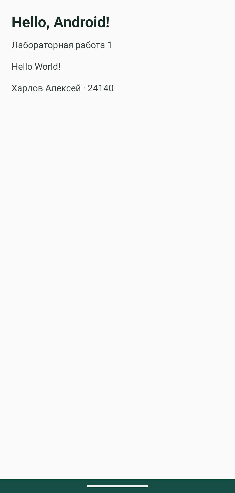
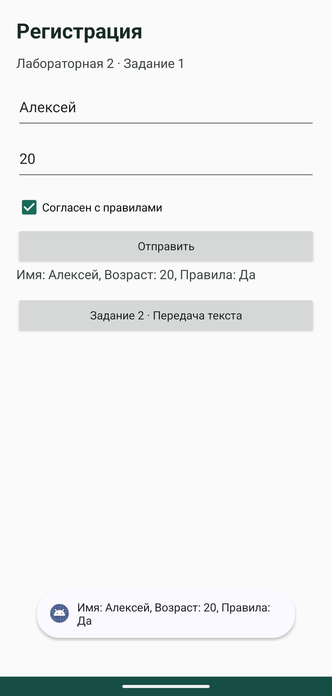
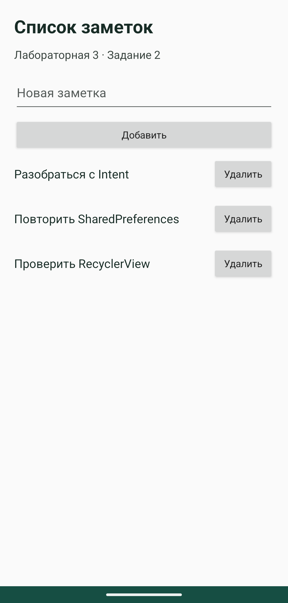
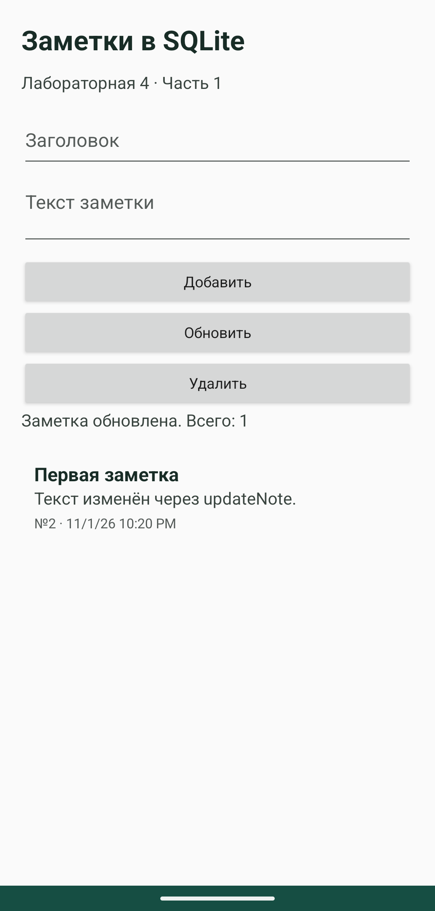
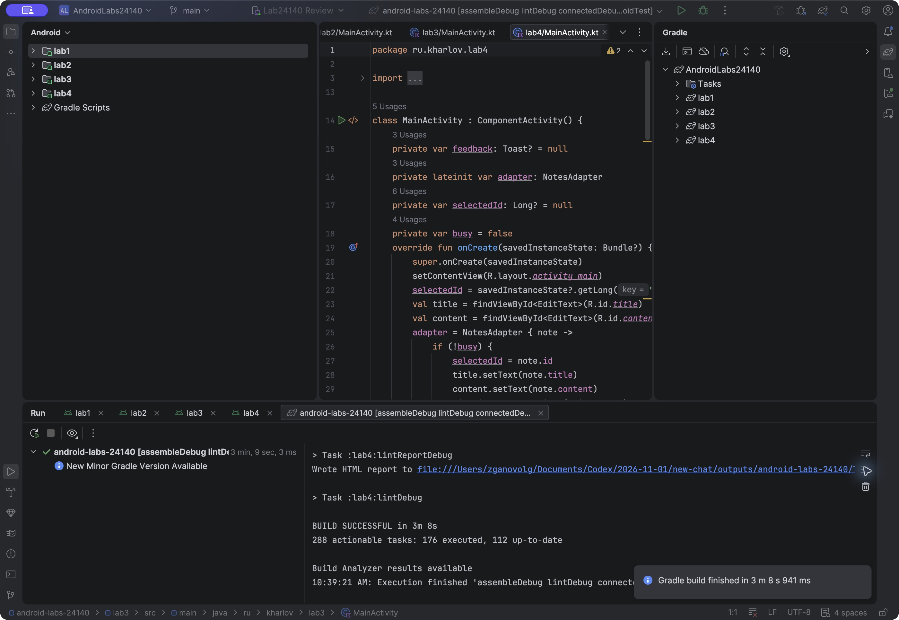

# Лабораторные работы по Android

Харлов Алексей, группа 24140.

В каждой папке `lab1`-`lab4` находится отдельное приложение. Отчёты с кодом и скриншотами можно открыть по ссылкам в таблице.

| Работа | Что сделано | Отчёт |
|---|---|---|
| 1 | Hello World | [Лаба 1](docs/lab1.md) |
| 2 | Форма, проверка ввода и передача текста между экранами | [Лаба 2](docs/lab2.md) |
| 3 | SharedPreferences, файл и список заметок с удалением | [Лаба 3](docs/lab3.md) |
| 4, часть 1 | Добавление, изменение и удаление заметок в SQLite | [Лаба 4](docs/lab4.md) |

## Скриншоты






В папках `lab1`-`lab4` внутри [docs/screenshots](docs/screenshots) находятся 33 снимка экранов приложений: формы, ошибки ввода, сохранение данных и работа со списками. Верхняя системная строка на этих снимках обрезана, содержимое экранов приложений сохранено.

## Android Studio

Проект открыт и синхронизирован в Android Studio Rabbit 2, версия 2026.2.2. Все четыре приложения собраны и запущены кнопкой Run во встроенном эмуляторе Android 15.

Окна Studio с кодом и запущенными приложениями: [лаба 1](docs/screenshots/studio/lab1.png), [лаба 2](docs/screenshots/studio/lab2.png), [лаба 3](docs/screenshots/studio/lab3.png), [лаба 4](docs/screenshots/studio/lab4.png).

Общая сборка, lint и тесты выполнены через панель Gradle в Studio:



## APK

[Скачать приложения](https://github.com/AlexeyBit112/android-labs-24140/releases/tag/v1.0).

## Как запустить

Открыть корневую папку в Android Studio, дождаться синхронизации и выбрать нужный модуль: `lab1`, `lab2`, `lab3` или `lab4`.

Для сборки нужны JDK 17, Android SDK 34 и Build Tools 34.0.0. Минимальная версия Android в проекте: 7.0, API 24. Gradle Wrapper уже добавлен.

В настройках Studio `Build, Execution, Deployment > Build Tools > Gradle` для `Gradle JDK` нужно выбрать JDK 17. Это важно, если новая версия Studio предлагает свой встроенный JDK 25.

При сборке из командной строки нужно задать `ANDROID_HOME` или указать путь к SDK в `local.properties`:

```properties
sdk.dir=/path/to/Android/sdk
```

```bash
./gradlew assembleDebug
```

APK появятся в папках `lab1/build/outputs/apk/debug/` и аналогичных папках остальных модулей.

## Проверка

В каждом модуле есть тест `LabScenarioTest`. Все четыре теста прошли на эмуляторе Android 15, API 35, при запуске из Gradle-панели Android Studio. Отдельно проверено, что SharedPreferences, файл и SQLite сохраняют данные после остановки процесса и нового запуска. На Android 7 отдельного запуска не было.

```bash
./gradlew lintDebug connectedDebugAndroidTest
./scripts/collect-screenshots.sh
python3 scripts/check-persistence.py
```

Для тестов нужен запущенный эмулятор или подключённый телефон. После прогона приложения остаются установленными, чтобы можно было забрать скриншоты. Lint прошёл без ошибок. Есть предупреждения о текстах в XML, autofill, разметке и новых версиях зависимостей.

Лаба 1 выполнена как Hello World по описанию задания. [Ссылка к первому занятию](https://developer.android.com/courses/pathways/android-basics-compose-unit-1-pathway-1) ведёт к основам Kotlin.
