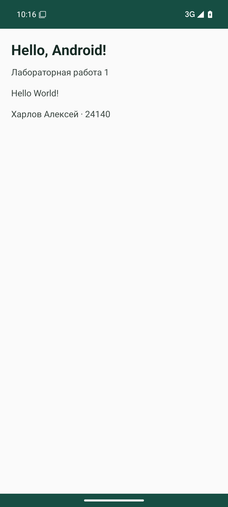

# Лабораторная работа 1

Харлов Алексей, группа 24140.

## Задача

Создать первое Android-приложение на Kotlin и вывести Hello World. Это предполагаемый объём первой работы по предоставленному описанию. Сама ссылка ведёт к вводным занятиям по Kotlin, а отдельного файла с заданием нет.

## Реализация

`MainActivity` наследуется от `ComponentActivity`. В `onCreate` подключается XML-макет с текстом приветствия. Здесь используется обычный `TextView`; Compose не требуется для последующих выданных заданий, которые разбирают XML и View.

```kotlin
package ru.kharlov.lab1

import android.os.Bundle
import android.widget.*
import androidx.activity.ComponentActivity

class MainActivity : ComponentActivity() {
    override fun onCreate(savedInstanceState: Bundle?) {
        super.onCreate(savedInstanceState)
        setContentView(R.layout.activity_main)
    }
}
```

Исходники: [MainActivity](../lab1/src/main/java/ru/kharlov/lab1/MainActivity.kt), [XML-макет](../lab1/src/main/res/layout/activity_main.xml).

## Результат

Тест проверяет содержимое `TextView`. Снимок сделан с запущенного приложения в Android Emulator.



## Вывод

Activity служит точкой входа в экран. Вызов `setContentView` связывает Kotlin-класс с ресурсом разметки, а Android загружает интерфейс при запуске Activity.
