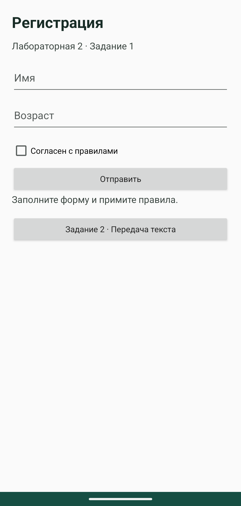
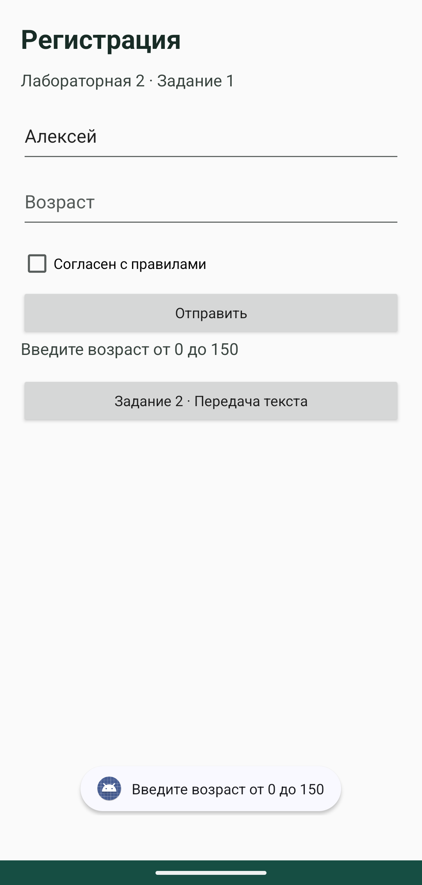
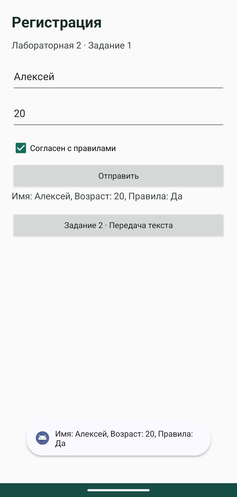
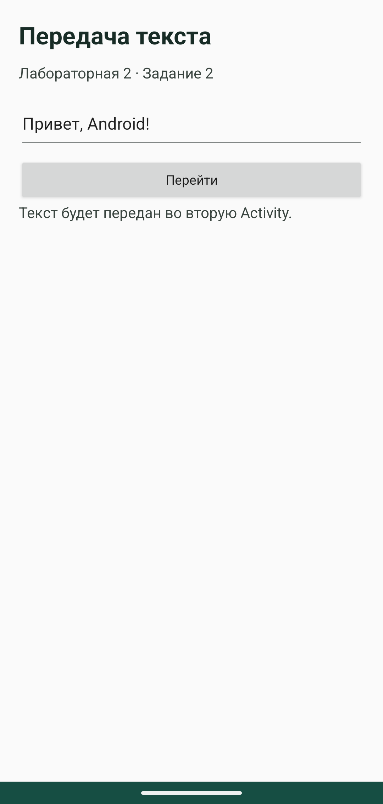
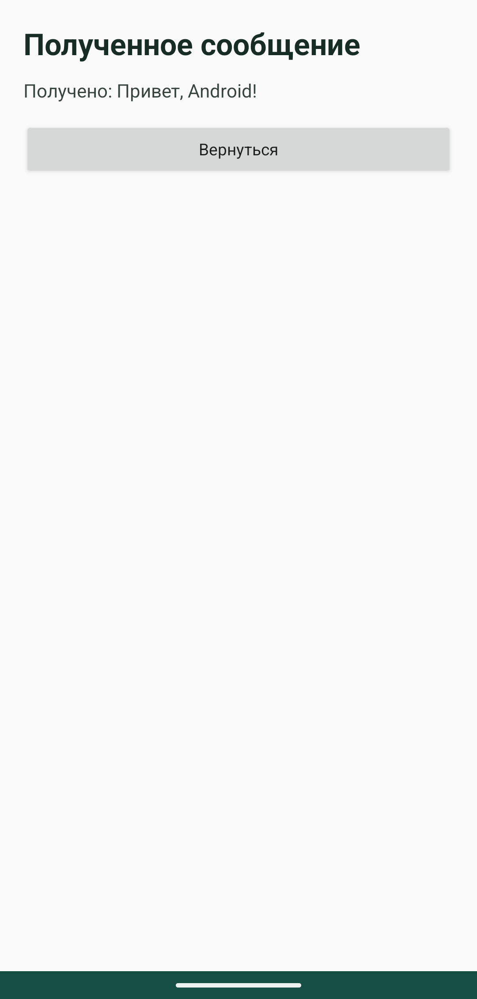
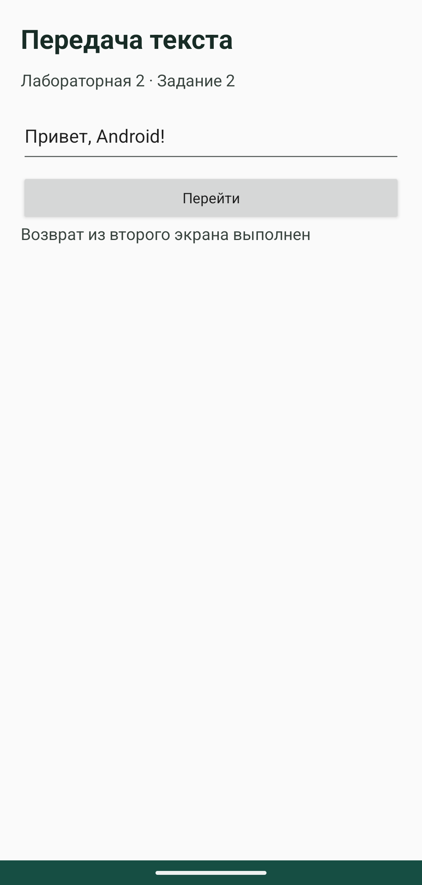

# Лабораторная работа 2

Харлов Алексей, группа 24140.

## Задание 1 Форма

В форме есть имя, возраст, галочка согласия и кнопка отправки. Для расположения элементов используется вертикальный `LinearLayout`. Форма прокручивается, если открытая клавиатура занимает часть экрана.

Перед отправкой `trim()` убирает пробелы по краям имени. Возраст проверяется через `toIntOrNull()`: допустимы числа от 0 до 150. При пустом имени, неправильном возрасте или снятой галочке появляется ошибка. Результат выводится в Toast и остаётся под кнопкой.

Обработка кнопки в [MainActivity](../lab2/src/main/java/ru/kharlov/lab2/MainActivity.kt):

```kotlin
findViewById<Button>(R.id.submit).setOnClickListener {
            val enteredName = name.text.toString().trim()
            val enteredAge = age.text.toString().trim().toIntOrNull()
            val message = when {
                enteredName.isEmpty() -> "Введите имя"
                enteredAge == null || enteredAge !in 0..150 -> "Введите возраст от 0 до 150"
                !agree.isChecked -> "Примите правила"
                else -> "Имя: $enteredName, Возраст: $enteredAge, Правила: Да"
            }
            findViewById<TextView>(R.id.result).text = message
            feedback?.cancel()
            feedback = Toast.makeText(this, message, Toast.LENGTH_LONG).also { it.show() }
        }
```

У поля возраста задан `inputType="number"`. В тесте также подставляются буквы и слишком большое число: приложение должно показать ошибку и продолжить работу.

| Сценарий | Ожидаемый результат |
|---|---|
| Пустое имя | Введите имя |
| Пустой возраст, 151, переполнение Int или буквы | Введите возраст от 0 до 150 |
| Корректные поля без согласия | Примите правила |
| Алексей, 20, согласие отмечено | Toast с введёнными данными |





Остальные снимки ошибок: [пустое имя](screenshots/lab2/02-empty-name.png), [согласие](screenshots/lab2/04-consent-required.png).

## Задание 2 Навигация

Схема экранов:

```text
MainActivity (форма)
    → NavigationActivity (ввод сообщения)
        → Intent.putExtra(EXTRA_MESSAGE, text)
        → DetailActivity (получение и показ текста)
        → finish()
    ← подтверждение возврата в NavigationActivity
```

Текст передаётся через `Intent.putExtra`. На втором экране он читается по тому же ключу `EXTRA_MESSAGE`. После возврата Activity Result API сообщает первому экрану, что второй экран закрыт.

[Передача текста](../lab2/src/main/java/ru/kharlov/lab2/NavigationActivity.kt):

```kotlin
package ru.kharlov.lab2

import android.os.Bundle
import android.widget.*
import androidx.activity.ComponentActivity
import android.content.Intent
import androidx.activity.result.contract.ActivityResultContracts

class NavigationActivity : ComponentActivity() {
    private val detail = registerForActivityResult(ActivityResultContracts.StartActivityForResult()) {
        if (it.resultCode == RESULT_OK) {
            findViewById<TextView>(R.id.status).text = "Возврат из второго экрана выполнен"
            Toast.makeText(this, "Вы вернулись", Toast.LENGTH_SHORT).show()
        }
    }
    override fun onCreate(savedInstanceState: Bundle?) {
        super.onCreate(savedInstanceState)
        setContentView(R.layout.activity_navigation)
        findViewById<Button>(R.id.go).setOnClickListener {
            val text = findViewById<EditText>(R.id.message).text.toString().trim()
            if (text.isEmpty()) {
                Toast.makeText(this, "Введите текст", Toast.LENGTH_SHORT).show()
                return@setOnClickListener
            }
            detail.launch(Intent(this, DetailActivity::class.java).putExtra(DetailActivity.EXTRA_MESSAGE, text))
        }
    }
}
```

[Получение текста и возврат](../lab2/src/main/java/ru/kharlov/lab2/DetailActivity.kt):

```kotlin
package ru.kharlov.lab2

import android.os.Bundle
import android.widget.*
import androidx.activity.ComponentActivity

class DetailActivity : ComponentActivity() {
    companion object { const val EXTRA_MESSAGE = "EXTRA_MESSAGE" }
    override fun onCreate(savedInstanceState: Bundle?) {
        super.onCreate(savedInstanceState)
        setContentView(R.layout.activity_detail)
        val message = intent.getStringExtra(EXTRA_MESSAGE) ?: "Нет данных"
        findViewById<TextView>(R.id.received).text = "Получено: $message"
        // Одинаковый результат для кнопки и системного возврата.
        setResult(RESULT_OK)
        findViewById<Button>(R.id.back).setOnClickListener { finish() }
    }
}
```





Запуск в Android Studio: [код и приложение в эмуляторе](screenshots/studio/lab2.png).

## Вывод

Проверка ввода нужна даже при числовой клавиатуре: пустая строка и слишком большое число остаются возможными. Intent передаёт данные по ключу, а `finish()` закрывает текущую Activity и возвращает управление предыдущей.
