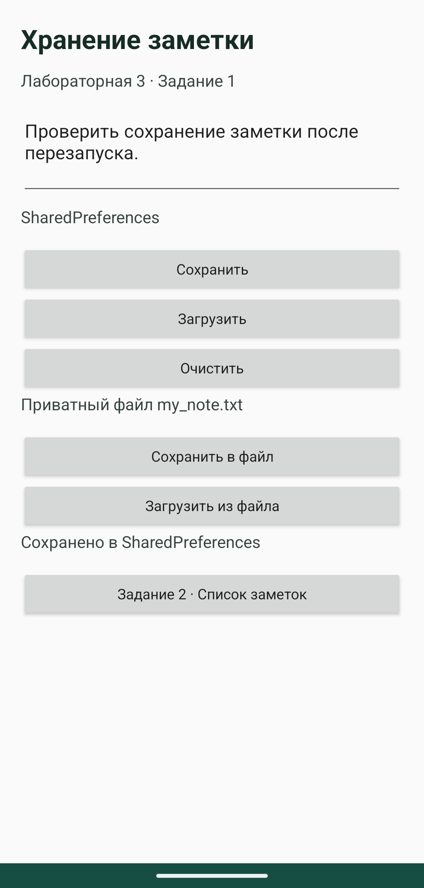
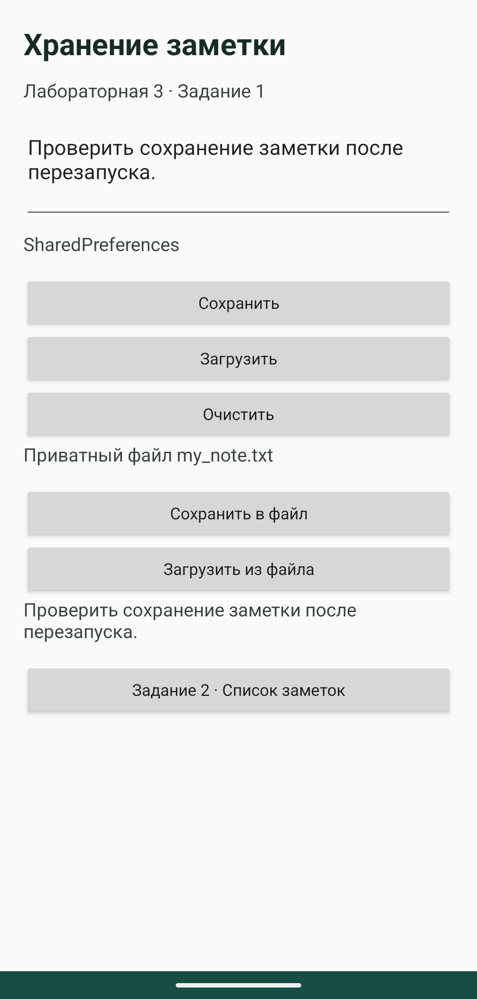
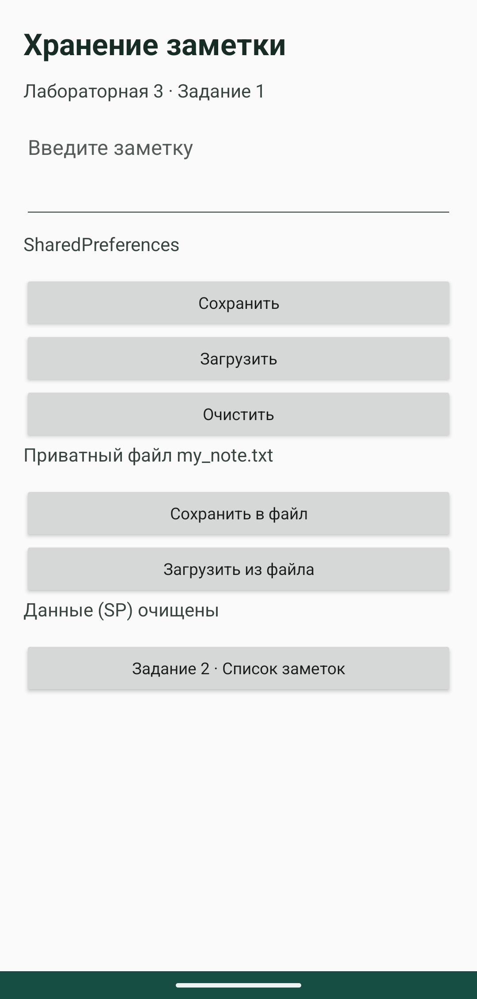
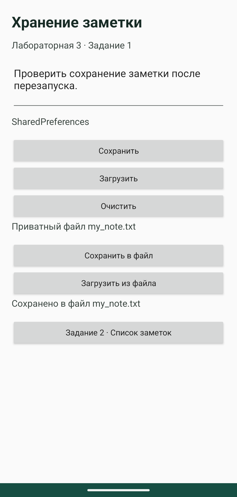
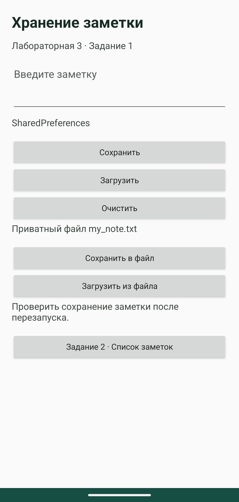
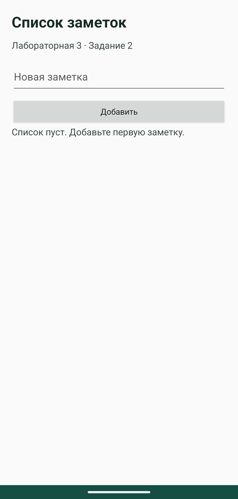
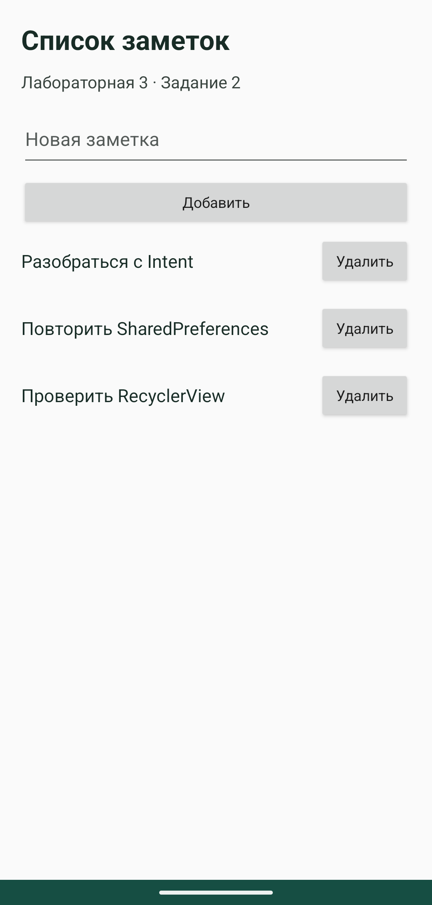
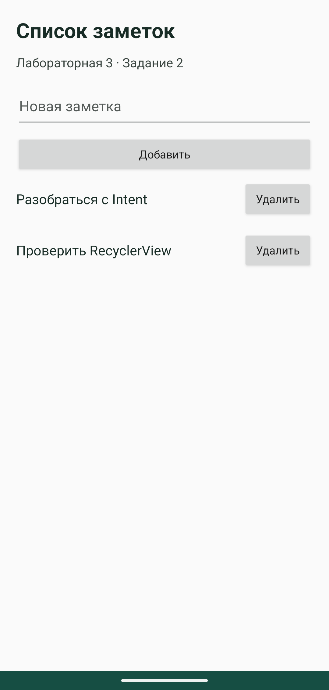

# Лабораторная работа 3

Харлов Алексей, группа 24140.

## Задание 1 Хранение заметки

На экране есть поле заметки, кнопки для SharedPreferences и файла, а также текст результата. Кнопка внизу открывает список из второго задания.

SharedPreferences хранят заметку под ключом `saved_note` в `NotesPrefs`. Сохранение использует `putString()` и `apply()`. Если сохранённой заметки нет, при загрузке появляется сообщение. Очистка удаляет значение через `remove()` и очищает поле ввода.

Файл `my_note.txt` создаётся в `filesDir`, поэтому разрешение на общий накопитель не требуется. Чтение и запись выполняются в `Dispatchers.IO`. Используется UTF-8. Пустой или состоящий из пробелов текст не сохраняется. Перед чтением проверяется `exists()`, ошибки ввода-вывода перехватываются.

[Основной код](../lab3/src/main/java/ru/kharlov/lab3/MainActivity.kt):

```kotlin
package ru.kharlov.lab3

import android.os.Bundle
import android.widget.*
import androidx.activity.ComponentActivity
import android.content.Intent
import androidx.lifecycle.lifecycleScope
import kotlinx.coroutines.Dispatchers
import kotlinx.coroutines.launch
import kotlinx.coroutines.withContext
import java.io.File
import java.io.IOException

class MainActivity : ComponentActivity() {
    private var feedback: Toast? = null
    companion object { const val NOTE_KEY = "saved_note" }
    override fun onCreate(savedInstanceState: Bundle?) {
        super.onCreate(savedInstanceState)
        setContentView(R.layout.activity_main)
        val prefs = getSharedPreferences("NotesPrefs", MODE_PRIVATE)
        val input = findViewById<EditText>(R.id.note)
        val file = File(filesDir, "my_note.txt")
        fun text(): String? {
            val value = input.text.toString()
            if (value.isBlank()) { show("Введите текст заметки"); return null }
            return value
        }
        findViewById<Button>(R.id.save).setOnClickListener {
            val value = text() ?: return@setOnClickListener
            prefs.edit().putString(NOTE_KEY, value).apply()
            show("Сохранено в SharedPreferences")
        }
        findViewById<Button>(R.id.load).setOnClickListener {
            val saved = prefs.getString(NOTE_KEY, null)
            show(if (saved.isNullOrEmpty()) "Нет сохранённой заметки (SP)" else saved)
        }
        findViewById<Button>(R.id.clear).setOnClickListener {
            prefs.edit().remove(NOTE_KEY).apply()
            input.text.clear()
            show("Данные (SP) очищены")
        }
        findViewById<Button>(R.id.saveFile).setOnClickListener {
            val value = text() ?: return@setOnClickListener
            lifecycleScope.launch {
                val message = withContext(Dispatchers.IO) {
                    try { file.writeText(value, Charsets.UTF_8); "Сохранено в файл my_note.txt" }
                    catch (e: IOException) { "Не удалось записать файл" }
                }
                show(message)
            }
        }
        findViewById<Button>(R.id.loadFile).setOnClickListener {
            lifecycleScope.launch {
                val message = withContext(Dispatchers.IO) {
                    try { if (file.exists()) file.readText(Charsets.UTF_8) else "Файл не найден" }
                    catch (e: IOException) { "Не удалось прочитать файл" }
                }
                show(message)
            }
        }
        findViewById<Button>(R.id.list).setOnClickListener {
            startActivity(Intent(this, ListActivity::class.java))
        }
    }
    private fun show(message: String) {
        findViewById<TextView>(R.id.result).text = message
        feedback?.cancel()
        feedback = Toast.makeText(this, message, Toast.LENGTH_SHORT).also { it.show() }
    }
    override fun onStop() {
        feedback?.cancel()
        super.onStop()
    }

}
```








Сценарии ошибок: [нет значения SP](screenshots/lab3/01-no-preferences.png), [нет файла](screenshots/lab3/02-no-file.png), [пустой ввод](screenshots/lab3/03-empty-input.png), [ошибка записи](screenshots/lab3/09-write-error.png), [ошибка чтения](screenshots/lab3/10-read-error.png).

Ошибки чтения и записи проверяются с помощью папки, временно созданной вместо файла `my_note.txt`. После проверки папка удаляется, и заметка снова сохраняется в файл.

SharedPreferences удобно использовать для настроек и небольших значений по ключу. Файл подходит для текстовой заметки. Очистка SharedPreferences оставляет файл на месте, поэтому его можно прочитать отдельно.

## Задание 2 RecyclerView

```text
ListActivity → RecyclerView → NotesAdapter → ViewHolder → item_note.xml
     │                            │
     └─ MutableList<String> ← callback удаления
```

`RecyclerView` размещает видимые строки и переиспользует их. `Adapter` связывает коллекцию с элементами интерфейса. `ViewHolder` хранит ссылки на текст и кнопку строки.

Список хранится в Activity и передаётся в адаптер. При добавлении вызывается `notifyItemInserted`. Удаление выполняется через `removeAt` и `notifyItemRemoved`. Позиция берётся из `bindingAdapterPosition` в момент нажатия, поскольку после удаления строки индексы соседних элементов меняются.

[Адаптер](../lab3/src/main/java/ru/kharlov/lab3/NotesAdapter.kt):

```kotlin
package ru.kharlov.lab3

import android.view.LayoutInflater
import android.view.View
import android.view.ViewGroup
import android.widget.Button
import android.widget.TextView
import androidx.recyclerview.widget.RecyclerView

class NotesAdapter(private val notes: MutableList<String>, private val onDelete: (Int) -> Unit) : RecyclerView.Adapter<NotesAdapter.Holder>() {
    class Holder(view: View) : RecyclerView.ViewHolder(view) {
        val text: TextView = view.findViewById(R.id.text)
        val delete: Button = view.findViewById(R.id.delete)
    }
    override fun onCreateViewHolder(parent: ViewGroup, viewType: Int) =
        Holder(LayoutInflater.from(parent.context).inflate(R.layout.item_note, parent, false))
    override fun getItemCount() = notes.size
    override fun onBindViewHolder(holder: Holder, position: Int) {
        holder.text.text = notes[position]
        holder.delete.setOnClickListener {
            val current = holder.bindingAdapterPosition
            if (current != RecyclerView.NO_POSITION) onDelete(current)
        }
    }
    fun removeNote(position: Int) {
        if (position !in notes.indices) return
        notes.removeAt(position)
        notifyItemRemoved(position)
    }
}
```

[Добавление и подключение адаптера](../lab3/src/main/java/ru/kharlov/lab3/ListActivity.kt):

```kotlin
package ru.kharlov.lab3

import android.os.Bundle
import android.widget.*
import androidx.activity.ComponentActivity
import android.view.View
import androidx.recyclerview.widget.LinearLayoutManager
import androidx.recyclerview.widget.RecyclerView

class ListActivity : ComponentActivity() {
    private val notes = mutableListOf<String>()
    override fun onCreate(savedInstanceState: Bundle?) {
        super.onCreate(savedInstanceState)
        setContentView(R.layout.activity_list)
        notes.addAll(savedInstanceState?.getStringArrayList("notes") ?: emptyList())
        val recycler = findViewById<RecyclerView>(R.id.recycler)
        lateinit var adapter: NotesAdapter
        fun emptyState() { findViewById<TextView>(R.id.empty).visibility = if (notes.isEmpty()) View.VISIBLE else View.GONE }
        adapter = NotesAdapter(notes) { position -> adapter.removeNote(position); emptyState() }
        recycler.layoutManager = LinearLayoutManager(this)
        recycler.adapter = adapter
        emptyState()
        findViewById<Button>(R.id.add).setOnClickListener {
            val input = findViewById<EditText>(R.id.newNote)
            val text = input.text.toString().trim()
            if (text.isEmpty()) {
                Toast.makeText(this, "Введите текст заметки", Toast.LENGTH_SHORT).show()
                return@setOnClickListener
            }
            notes.add(text)
            adapter.notifyItemInserted(notes.lastIndex)
            recycler.scrollToPosition(notes.lastIndex)
            input.text.clear()
            emptyState()
        }
    }
    override fun onSaveInstanceState(outState: Bundle) {
        outState.putStringArrayList("notes", ArrayList(notes))
        super.onSaveInstanceState(outState)
    }
}
```





Список сохраняется в Bundle при пересоздании экрана, включая поворот. При новом запуске после завершения задачи он пуст: в этом задании используется коллекция в памяти. Постоянное хранение списка реализовано отдельно в лабе 4.

Сохранение также проверено после `am force-stop` и нового запуска приложения: [SharedPreferences](screenshots/lab3/14-after-process-restart.png), [файл](screenshots/lab3/15-file-after-process-restart.png).

Запуск в Android Studio: [код и приложение в эмуляторе](screenshots/studio/lab3.png).

## Вывод

Способ хранения выбирается по структуре данных. Для одного значения достаточно SharedPreferences, для текста подходит файл, а RecyclerView отвечает только за отображение коллекции и сам ничего на диск не сохраняет.

Документация: [SharedPreferences](https://developer.android.com/training/data-storage/shared-preferences).
