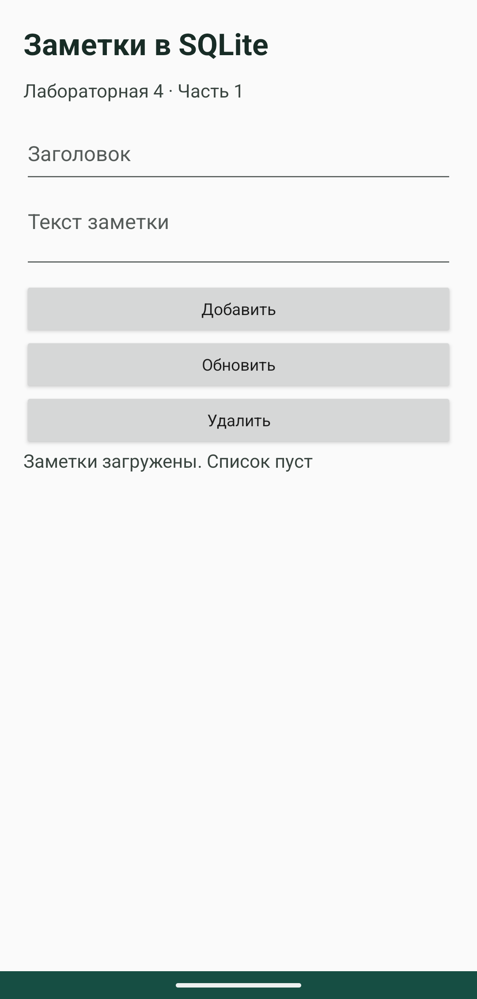
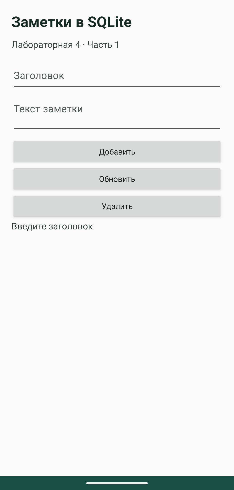
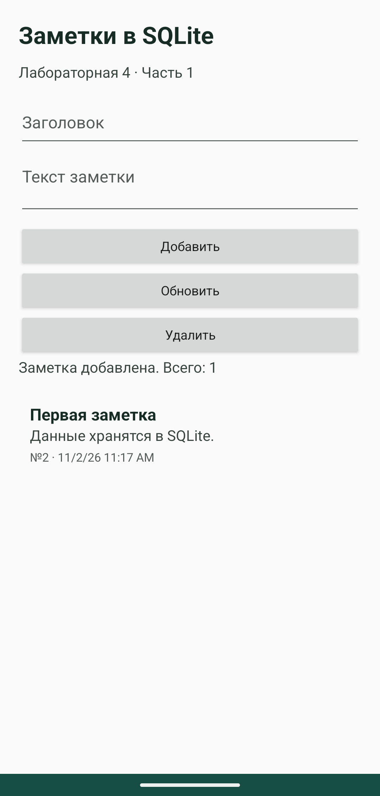
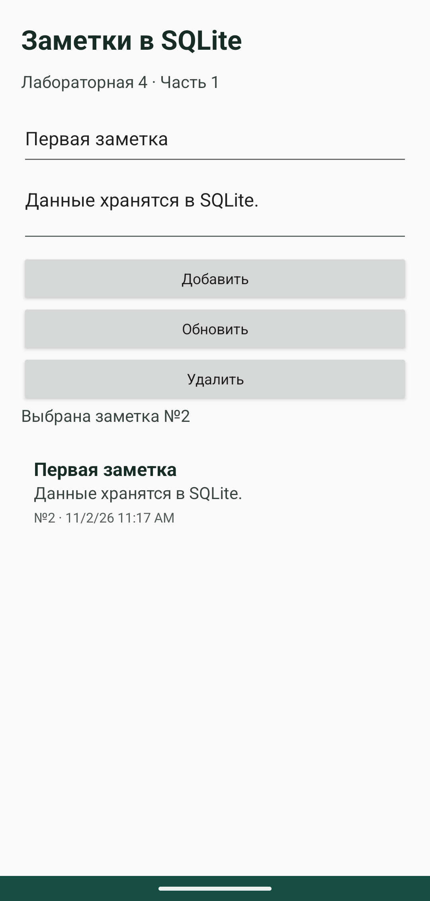
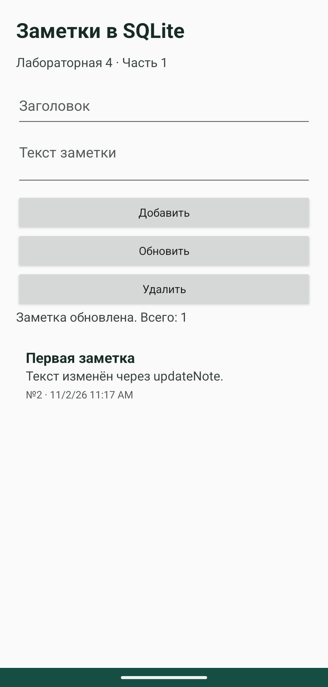
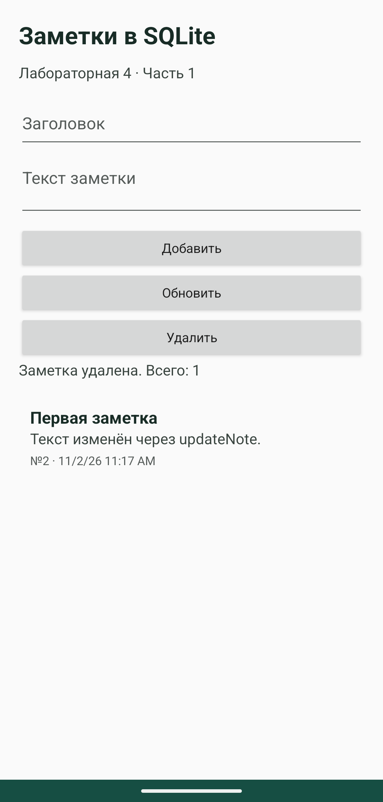

# Лабораторная работа 4 Часть 1

Харлов Алексей, группа 24140.

## Работа с заметками

Заметки хранятся в штатной SQLite через `SQLiteOpenHelper`, без Room. Таблица `notes` содержит `id`, `title`, `content` и `timestamp`. RecyclerView выводит заметки в порядке последнего изменения. Нажатие на строку выбирает запись и переносит данные в поля формы.

Кнопка «Добавить» создаёт запись. Для обновления и удаления сначала нужно выбрать заметку. Пустой заголовок не допускается. Результат операции выводится в текстовом блоке и Toast. На время запроса кнопки блокируются.

## SQLiteOpenHelper и CRUD

[NotesDbHelper](../lab4/src/main/java/ru/kharlov/lab4/NotesDbHelper.kt):

```kotlin
package ru.kharlov.lab4

import android.content.Context
import android.content.ContentValues
import android.database.sqlite.SQLiteDatabase
import android.database.sqlite.SQLiteOpenHelper

class NotesDbHelper(context: Context) : SQLiteOpenHelper(context, "notes.db", null, 1) {
    override fun onCreate(db: SQLiteDatabase) {
        db.execSQL("CREATE TABLE notes (id INTEGER PRIMARY KEY AUTOINCREMENT, title TEXT NOT NULL, content TEXT NOT NULL, timestamp INTEGER NOT NULL)")
    }
    override fun onUpgrade(db: SQLiteDatabase, oldVersion: Int, newVersion: Int) {
        // Учебная стратегия: при изменении версии данные удаляются.
        db.execSQL("DROP TABLE IF EXISTS notes")
        onCreate(db)
    }
    private fun values(title: String, content: String) = ContentValues().apply {
        put("title", title)
        put("content", content)
        put("timestamp", System.currentTimeMillis())
    }
    fun insertNote(title: String, content: String): Long =
        writableDatabase.insert("notes", null, values(title, content))
    fun getAllNotes(): List<Note> {
        val notes = mutableListOf<Note>()
        readableDatabase.rawQuery("SELECT * FROM notes ORDER BY timestamp DESC, id DESC", null).use { cursor ->
            val id = cursor.getColumnIndexOrThrow("id")
            val title = cursor.getColumnIndexOrThrow("title")
            val content = cursor.getColumnIndexOrThrow("content")
            val timestamp = cursor.getColumnIndexOrThrow("timestamp")
            while (cursor.moveToNext()) {
                notes.add(Note(cursor.getLong(id), cursor.getString(title), cursor.getString(content), cursor.getLong(timestamp)))
            }
        }
        return notes
    }
    fun updateNote(id: Long, title: String, content: String): Int =
        writableDatabase.update("notes", values(title, content), "id = ?", arrayOf(id.toString()))
    fun deleteNote(id: Long): Int =
        writableDatabase.delete("notes", "id = ?", arrayOf(id.toString()))
}
```

`onCreate` создаёт таблицу. В учебном `onUpgrade` старая таблица удаляется и создаётся заново. Такая стратегия теряет данные и годится только для этого учебного примера.

После чтения `cursor.use` закрывает курсор. Activity создаёт helper на время операции и тоже закрывает его через `use`. Для поиска записи используется условие `id = ?`, а сам ID передаётся отдельным аргументом.

Вызовы БД выполняются в `withContext(Dispatchers.IO)`. После возврата корутина продолжает работу на главном потоке, где обновляются поля и адаптер. Срок жизни корутины связан с Activity через `lifecycleScope`.

[Выполнение фоновой операции](../lab4/src/main/java/ru/kharlov/lab4/MainActivity.kt):

```kotlin
private fun operation(clearForm: Boolean = true, action: (NotesDbHelper) -> String) {
        if (busy) return
        busy = true
        controls(false)
        lifecycleScope.launch {
            try {
                val (message, notes) = withContext(Dispatchers.IO) {
                    // Отдельный helper на операцию закрывается в том же потоке.
                    NotesDbHelper(applicationContext).use { db -> action(db) to db.getAllNotes() }
                }
                adapter.submitList(notes)
                if (clearForm) {
                    selectedId = null
                    findViewById<EditText>(R.id.title).text.clear()
                    findViewById<EditText>(R.id.content).text.clear()
                }
                show(if (notes.isEmpty()) "$message. Список пуст" else "$message. Всего: ${notes.size}")
            } catch (e: SQLiteException) {
                show("Не удалось выполнить операцию с базой данных")
            } finally { busy = false; controls(true) }
        }
    }
```

## Адаптер списка

[NotesAdapter](../lab4/src/main/java/ru/kharlov/lab4/NotesAdapter.kt):

```kotlin
package ru.kharlov.lab4

import android.view.LayoutInflater
import android.view.View
import android.view.ViewGroup
import android.widget.TextView
import androidx.recyclerview.widget.DiffUtil
import androidx.recyclerview.widget.ListAdapter
import androidx.recyclerview.widget.RecyclerView
import java.text.DateFormat
import java.util.Date

class NotesAdapter(private val onSelect: (Note) -> Unit) : ListAdapter<Note, NotesAdapter.Holder>(Diff) {
    object Diff : DiffUtil.ItemCallback<Note>() {
        override fun areItemsTheSame(old: Note, new: Note) = old.id == new.id
        override fun areContentsTheSame(old: Note, new: Note) = old == new
    }
    class Holder(view: View) : RecyclerView.ViewHolder(view)
    override fun onCreateViewHolder(parent: ViewGroup, viewType: Int) =
        Holder(LayoutInflater.from(parent.context).inflate(R.layout.item_note, parent, false))
    override fun onBindViewHolder(holder: Holder, position: Int) {
        val note = getItem(position)
        holder.itemView.findViewById<TextView>(R.id.noteTitle).text = note.title
        holder.itemView.findViewById<TextView>(R.id.noteContent).text = note.content
        holder.itemView.findViewById<TextView>(R.id.date).text = "№${note.id} · ${DateFormat.getDateTimeInstance(DateFormat.SHORT, DateFormat.SHORT).format(Date(note.timestamp))}"
        holder.itemView.contentDescription = "Заметка: ${note.title}"
        holder.itemView.setOnClickListener { onSelect(note) }
    }
}
```

После запроса новый список передаётся в `ListAdapter`. `DiffUtil` сравнивает ID и содержимое заметок и обновляет изменившиеся строки.

Запуск в Android Studio: [код и приложение в эмуляторе](screenshots/studio/lab4.png).

## Проверка









Проверены добавление, выбор, изменение и удаление заметки, а также ошибка пустого заголовка. В тесте helper отдельно проверяются кавычки в тексте и обращение к несуществующему ID. Запись остаётся в базе [после пересоздания Activity](screenshots/lab4/06-after-recreate.png).

Дополнительные проверки: [горизонтальный экран](screenshots/lab4/08-landscape.png) и [данные после остановки процесса](screenshots/lab4/09-after-process-restart.png).

## Сравнение с Room

В `NotesDbHelper.kt` получилось 38 непустых строк без комментариев. Вместе с моделью `Note` получается 40 строк. Вариант с Room ниже занимает 19 строк без импортов и настроек KSP. Это пример для сравнения, в приложение он не подключён.

```kotlin
@Entity(tableName = "notes")
data class Note(
    @PrimaryKey(autoGenerate = true) val id: Long = 0,
    val title: String,
    val content: String,
    val timestamp: Long
)
@Dao
interface NotesDao {
    @Insert suspend fun insert(note: Note): Long
    @Query("SELECT * FROM notes ORDER BY timestamp DESC, id DESC")
    suspend fun getAllNotes(): List<Note>
    @Update suspend fun update(note: Note): Int
    @Delete suspend fun delete(note: Note): Int
}
@Database(entities = [Note::class], version = 1)
abstract class NotesDatabase : RoomDatabase() {
    abstract fun notesDao(): NotesDao
}
```

У прямой SQLite видны SQL, порядок чтения полей и момент закрытия ресурсов. Это даёт полный контроль, но добавляет повторяющийся код и риск ошибиться в имени столбца, преобразовании данных или обработке Cursor. Room сокращает эту часть и проверяет запросы при сборке. Для сложной модели данных он обычно удобнее.

Рабочий вариант с Room находится в [лабораторной 5](lab5.md).

Документация: [SQLite в Android](https://developer.android.com/training/data-storage/sqlite).
