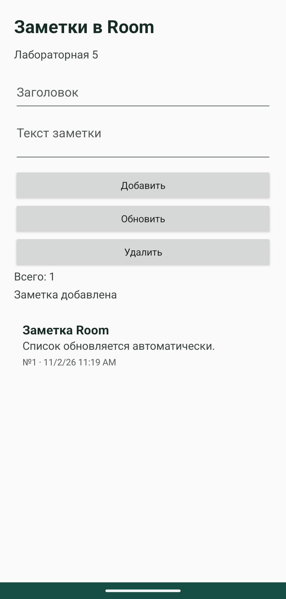
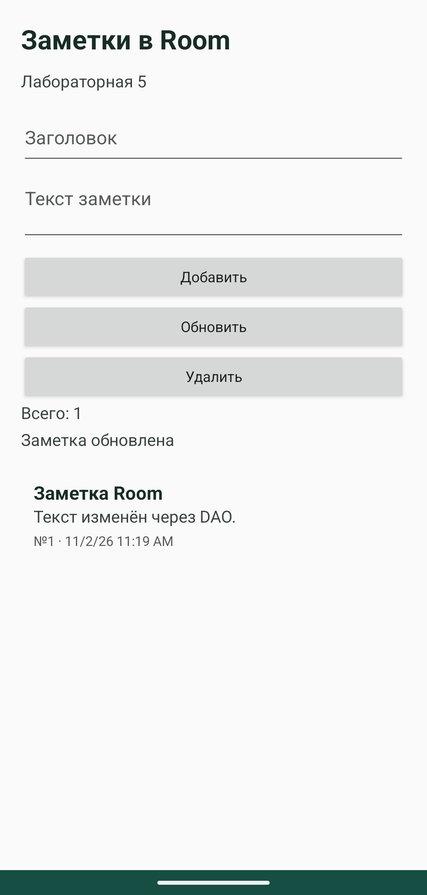
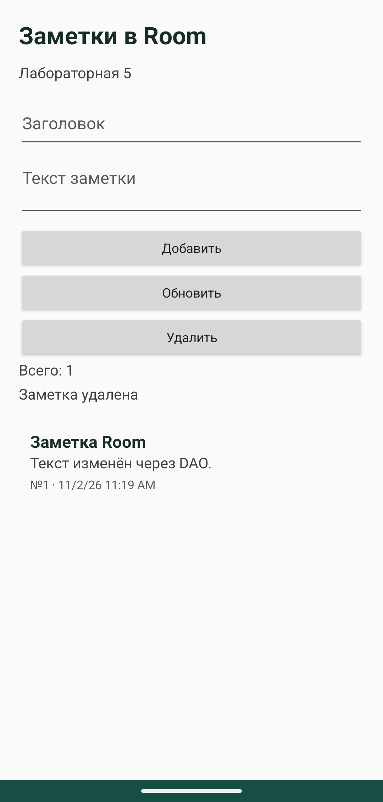

# Лабораторная работа 5

Харлов Алексей, группа 24140.

## Задача

Сделать приложение заметок на SQLite через Room. Нужны добавление, чтение, изменение и удаление записей, выбор заметки из списка и проверка заголовка. Список должен обновляться после изменения базы.

Модуль `lab5` создан в Android Studio через Empty Views Activity. Используются Kotlin, XML и RecyclerView. Зависимости Room 2.6.1 и корутин взяты из задания, генерация кода подключена через kapt.

## Сущность Note

[Note.kt](../lab5/src/main/java/ru/kharlov/lab5/Note.kt) описывает строку таблицы `notes`. При вставке новой заметки Room сам получает ID из SQLite. `timestamp` хранит время создания или последнего изменения.

```kotlin
@Entity(tableName = "notes")
data class Note(
    @PrimaryKey(autoGenerate = true) val id: Int = 0,
    val title: String,
    val content: String,
    val timestamp: Long = System.currentTimeMillis()
)
```

## DAO

В [NoteDao.kt](../lab5/src/main/java/ru/kharlov/lab5/NoteDao.kt) находятся четыре операции. Для изменения и удаления Room использует первичный ключ `id` переданного объекта.

```kotlin
@Dao
interface NoteDao {
    @Insert
    suspend fun insert(note: Note): Long

    @Update
    suspend fun update(note: Note): Int

    @Delete
    suspend fun delete(note: Note): Int

    @Query("SELECT * FROM notes ORDER BY timestamp DESC, id DESC")
    fun getAll(): LiveData<List<Note>>
}
```

`getAll()` возвращает `LiveData<List<Note>>`. Если таблица изменилась, Room повторяет запрос и передаёт новый список наблюдателю. Повторно загружать данные после каждого нажатия кнопки не нужно.

## База данных

[AppDatabase.kt](../lab5/src/main/java/ru/kharlov/lab5/AppDatabase.kt) регистрирует сущность и предоставляет DAO. На процесс приложения создаётся один экземпляр базы. Для него используется `applicationContext`, чтобы не хранить ссылку на Activity.

```kotlin
@Database(entities = [Note::class], version = 1, exportSchema = true)
abstract class AppDatabase : RoomDatabase() {
    abstract fun noteDao(): NoteDao

    companion object {
        @Volatile private var instance: AppDatabase? = null

        fun getDatabase(context: Context): AppDatabase =
            instance ?: synchronized(this) {
                instance ?: Room.databaseBuilder(
                    context.applicationContext,
                    AppDatabase::class.java,
                    "room_notes.db"
                ).build().also { instance = it }
            }
    }
}
```

Данные находятся в приватном файле `room_notes.db`. Версия схемы сейчас 1. Room экспортирует её в [JSON](../lab5/schemas/ru.kharlov.lab5.AppDatabase/1.json), который можно использовать при подготовке и проверке миграций. В этой работе структура таблицы между версиями не менялась.

## Repository и ViewModel

[NotesRepository.kt](../lab5/src/main/java/ru/kharlov/lab5/NotesRepository.kt) передаёт обращения к базе в DAO:

```kotlin
class NotesRepository(private val dao: NoteDao) {
    val allNotes = dao.getAll()

    suspend fun insert(note: Note): Long = dao.insert(note)
    suspend fun update(note: Note): Int = dao.update(note)
    suspend fun delete(note: Note): Int = dao.delete(note)
}
```

[NoteViewModel.kt](../lab5/src/main/java/ru/kharlov/lab5/NoteViewModel.kt) хранит выбранную заметку, проверяет ввод и запускает операции. Пустой заголовок, в том числе строка из пробелов, не сохраняется.

```kotlin
fun insert(title: String, content: String) {
        val heading = title.trim()
        if (heading.isEmpty()) { notice.value = "Введите заголовок"; return }
        change {
            val id = repository.insert(Note(title = heading, content = content))
            if (id > 0) "Заметка добавлена" else "Не удалось добавить заметку"
        }
    }
```

Для обновления берётся выбранная заметка и создаётся её копия с новым заголовком, текстом и временем. ID остаётся прежним. Удаление также использует выбранный объект с его ID. Если строка не найдена, приложение сообщает об этом.

Операции запускаются в `viewModelScope`:

```kotlin
private fun change(action: suspend () -> String) {
        if (working.value == true) return
        viewModelScope.launch {
            working.value = true
            try {
                val text = action()
                selected.value = null
                notice.value = text
            } catch (e: CancellationException) {
                throw e
            } catch (e: Exception) {
                Log.e("RoomNotes", "Database operation failed", e)
                notice.value = "Не удалось выполнить операцию с базой данных"
            } finally {
                working.value = false
            }
        }
    }
```

Методы DAO объявлены как `suspend`. Room выполняет SQL в своих фоновых исполнителях, поэтому запросы не блокируют главный поток. Пока операция идёт, кнопки и поля временно отключены. При ошибке введённый текст остаётся в форме.

## Экран и список

В [MainActivity.kt](../lab5/src/main/java/ru/kharlov/lab5/MainActivity.kt) подключён ViewModel и наблюдение за списком:

```kotlin
viewModel.allNotes.observe(this) { notes ->
            adapter.submitList(notes)
            findViewById<TextView>(R.id.count).text = getString(R.string.count_notes, notes.size)
        }
```

[NotesAdapter.kt](../lab5/src/main/java/ru/kharlov/lab5/NotesAdapter.kt) использует `ListAdapter` и `DiffUtil`. Нажатие на строку передаёт выбранную заметку во ViewModel, после чего заголовок и текст появляются в полях. Выбор сохраняется при повороте экрана.

## Проверка





| Действие | Результат |
|---|---|
| [Первый запуск](screenshots/lab5/01-empty.png) | Список пуст, счётчик показывает 0 |
| [Добавление без заголовка](screenshots/lab5/02-title-required.png) | Ошибка, запись не добавлена |
| [Обновление или удаление без выбора](screenshots/lab5/03-selection-required.png) | Сообщение о необходимости выбрать заметку |
| [Добавление](screenshots/lab5/04-added.png) | Запись появляется в списке, счётчик обновляется |
| [Выбор строки](screenshots/lab5/05-selected.png) | Поля заполняются данными заметки |
| [Пустой заголовок при изменении](screenshots/lab5/06-title-required-update.png) | Обновление отклонено |
| [Обновление](screenshots/lab5/07-updated.png) | У той же записи меняется текст |
| [Две заметки](screenshots/lab5/08-two-notes.png) | В списке обе записи |
| [Удаление второй записи](screenshots/lab5/09-deleted.png) | Первая остаётся в списке |
| [Пересоздание Activity](screenshots/lab5/10-after-recreate.png) | Заметка остаётся доступна |
| [Поворот экрана](screenshots/lab5/11-landscape.png) | Выбор и несохранённый текст сохраняются |
| [Остановка процесса и новый запуск](screenshots/lab5/12-after-process-restart.png) | Данные читаются из базы |

В [RoomDatabaseTest](../lab5/src/androidTest/java/ru/kharlov/lab5/RoomDatabaseTest.kt) проверены CRUD, публикация изменений в LiveData, текст с кавычками, отсутствующий ID и повторное открытие файла базы. [LabScenarioTest](../lab5/src/androidTest/java/ru/kharlov/lab5/LabScenarioTest.kt) выполняет действия в интерфейсе. Все три теста пятой лабы прошли на Android 15, API 35.

[Запуск lab5 в Android Studio](screenshots/studio/lab5.png). [Общий результат сборки, lint и тестов](screenshots/studio/tests.png).

## Вывод

Room остаётся надстройкой над штатной SQLite. В сравнении с четвёртой лабой здесь не нужны ручной обход Cursor, чтение столбцов по именам и SQL создания таблицы. Этот код генерируется по сущности и DAO.

Room проверяет SQL-запросы при сборке и связывает значения с параметрами запросов. LiveData обновляет список при изменении таблицы. Для изменения схемы предусмотрены версии базы и миграции, которые нужно явно добавить или описать через AutoMigration. Сама библиотека не заменяет проверку пользовательского ввода.

Для новых Android-приложений Room рекомендуется как слой работы с SQLite. В этой работе он убрал часть повторяющегося кода и отделил доступ к данным от Activity.

Документация: [Room](https://developer.android.com/training/data-storage/room), [DAO](https://developer.android.com/training/data-storage/room/accessing-data).
